# System Flow Diagrams

Tai lieu nay tong hop cac luong xu ly chinh hien tai cua Fulfillment Platform v2.

Pham vi:

- Nhan don tu Portal.
- Auto shipment theo SKU + country mapping.
- Tao shipment thu cong va batch shipment.
- Tracking callback ve Portal theo source Amazon/Etsy.
- Confirm ship, cancel, reset order.
- Shipment cost estimate, actual fee, va YunExpress webhook.
- Security/tenancy boundary o muc flow.

Khong bao gom:

- Legacy draft/preflight shipment flow la luong chinh. Mot so route legacy van ton tai trong code, nhung business flow hien tai la direct YunExpress shipping.
- Chi tiet UI layout tung component.
- Carrier credentials/secret values.

## 1. High-Level System Context

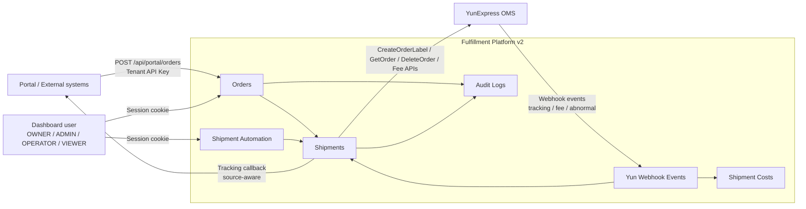

## 2. Order Status Lifecycle

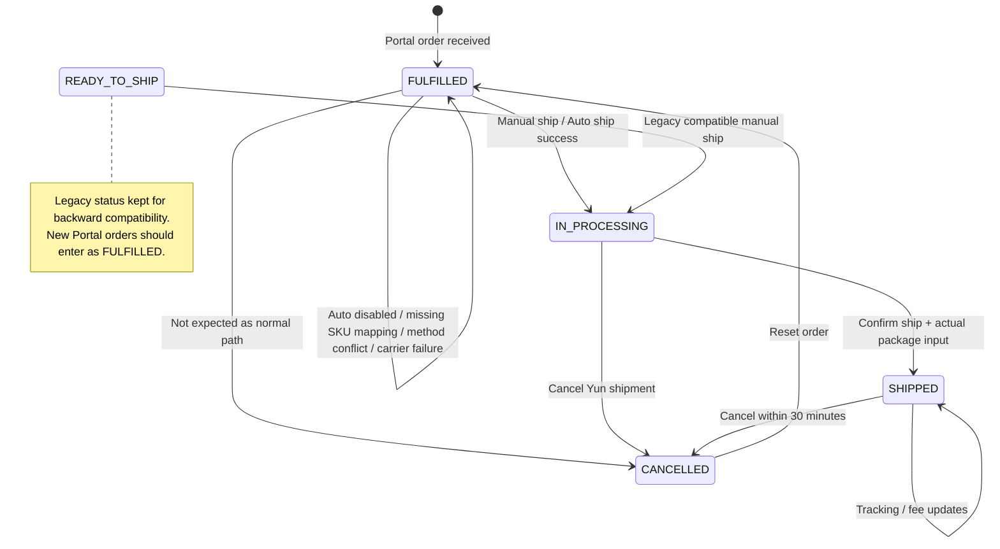

## 3. Portal Receive Order Flow

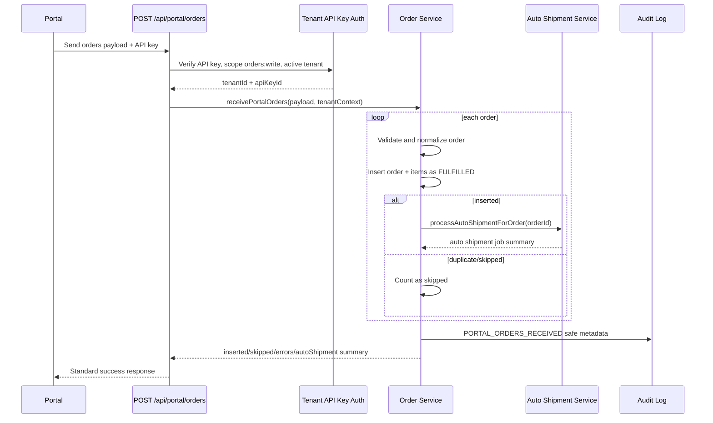

Important rules:

- Tenant is resolved only from tenant API key.
- Body-provided `tenantId` is ignored for business scoping.
- New orders are created as `FULFILLED`.
- Auto shipment is attempted only for newly inserted orders.
- API key must have `orders:write`.

## 4. Auto Shipment Flow

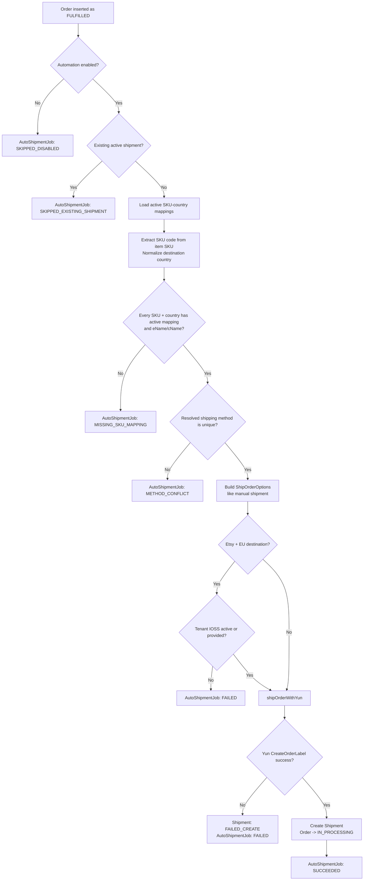

Auto mapping contract:

- Mapping key is `tenantId + skuCode + destinationCountryCode`.
- `skuCode` is extracted from SKU, for example SKU containing product code like `NK`.
- Mapping stores `shippingMethodCode`, `eName`, `cName`, `status`.
- Only `ACTIVE` mappings are used.
- Default package values for auto shipment are estimate values unless edited later.
- Missing phone defaults to `0123456789` when building auto shipment options.

## 5. Manual Single Shipment Flow

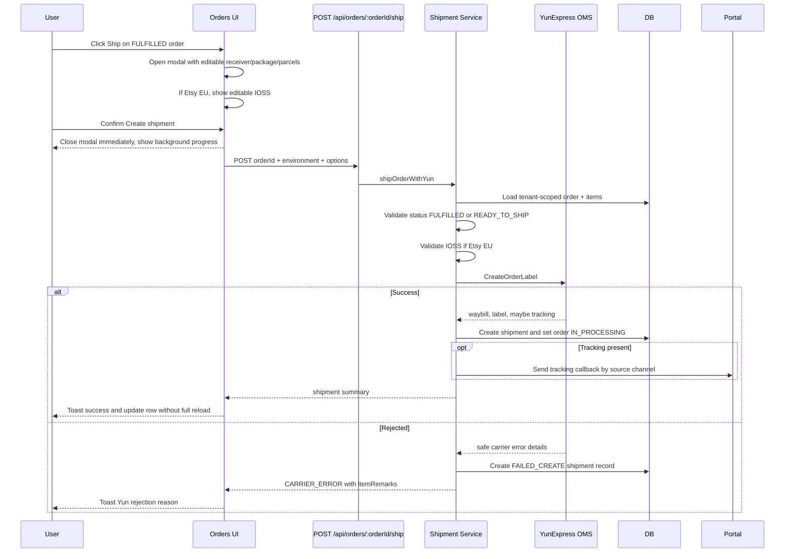

Manual shipment fields:

- Main: `ShippingMethodCode`, `CustomerOrderNumber`, `SourceCode`.
- Receiver: first/last name, company, country, street, city, state, zip, phone, email.
- Package: weight, length, width, height, size units, package count, application type, return option, tariff prepay, insurance option.
- Parcels: SKU, EName, CName, quantity, unit price, unit weight, currency code, invoice part, invoice usage, remark.
- Etsy EU: IOSS number.

## 6. Batch Shipment Flow

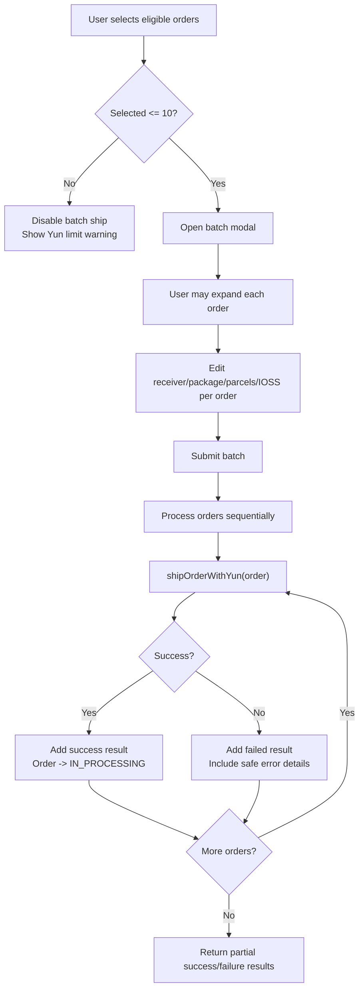

Batch behavior:

- Eligible order statuses: `FULFILLED`, plus legacy `READY_TO_SHIP`.
- Yun batch limit in UI: max 10 orders.
- Current service processes each order through the same single-order `shipOrderWithYun` path.
- Partial failures do not fail the entire batch response.
- Each order can carry its own manual overrides from expanded modal.

## 7. Tracking Handling Flow

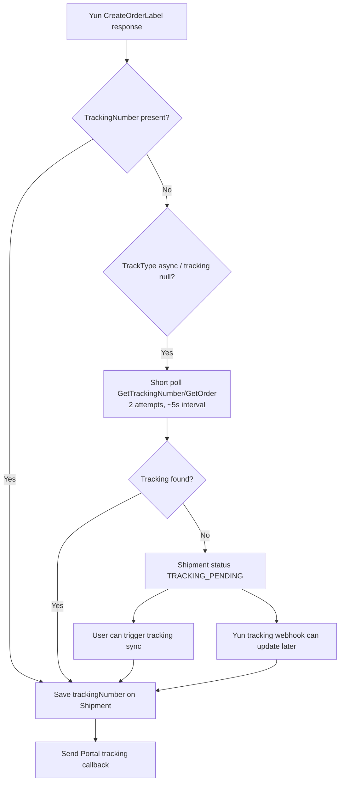

Source-aware Portal callback:

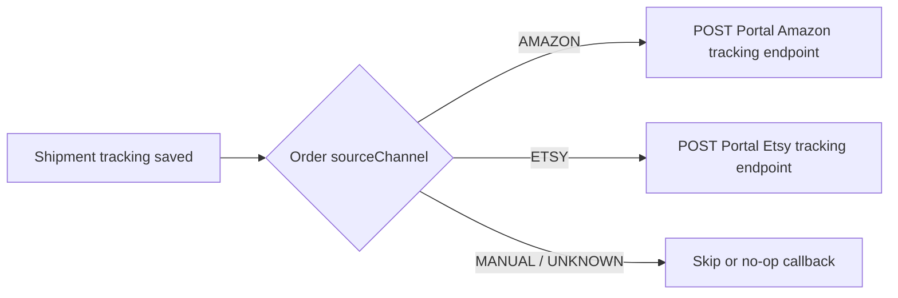

## 8. Confirm Ship And Cost Estimate Flow

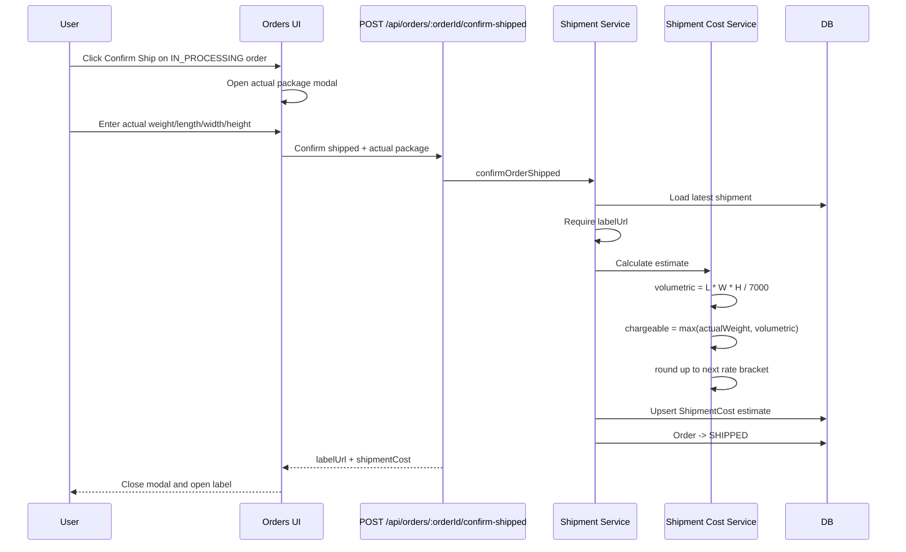

Cost rules:

- Actual dimensions are captured at confirm time.
- Estimated chargeable weight is the larger of actual weight and volumetric weight.
- Estimate uses the configured rate table/bracket logic.
- Actual fee is pulled later from Yun or updated by webhook.

## 9. Cancel And Reset Flow

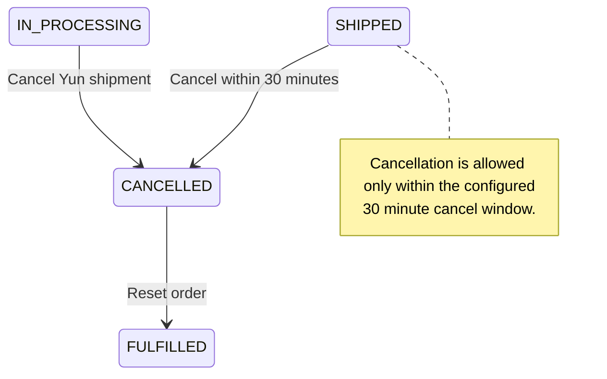

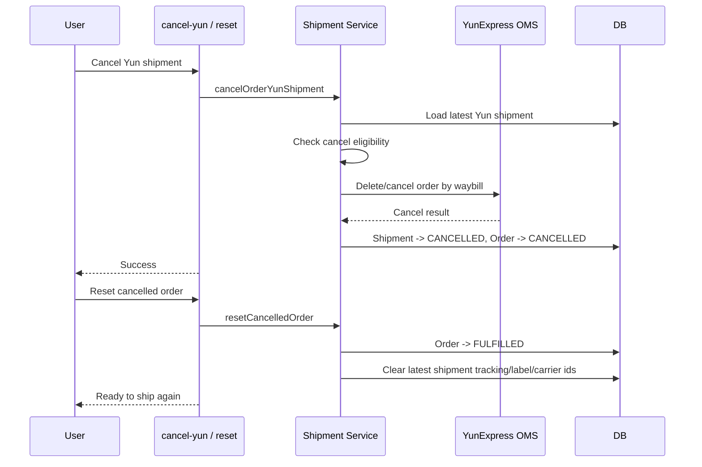

## 10. Shipping Cost Actual Fee Flow

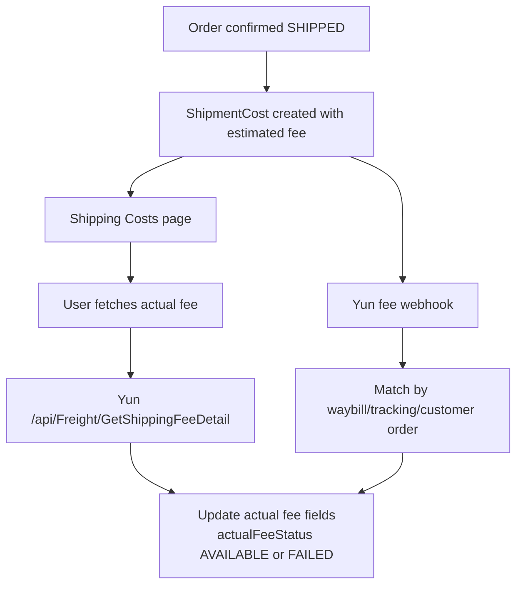

Displayed data:

- Estimated: actual dimensions, volumetric weight, chargeable weight, estimated fee.
- Actual: total cost shown in table.
- Actual fee detail: freight, fuel surcharge, registration fee, processing fee, other fee, gross/charge weight, occurrence time.
- Actual fee may be fetched again even after it was already available.

## 11. YunExpress Webhook Flow

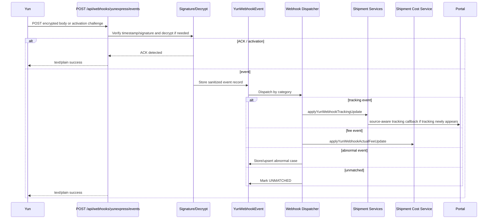

Webhook rules:

- Public receiver does not use dashboard session or tenant API key.
- Verification uses Yun signature headers and encrypted body.
- Response to accepted webhook/challenge is plain text `success`.
- Raw encrypted body is stored server-side, but management APIs/UI expose only sanitized payloads.
- Webhook must not create fake orders or shipments if no match is found.

## 12. Dashboard Authorization Flow

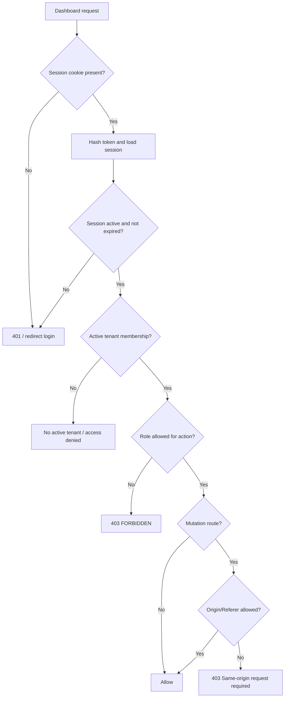

Role intent:

- `OWNER`, `ADMIN`: manage settings, members, API keys, shipment automation, carrier accounts.
- `OPERATOR`: operate orders, shipments, tracking.
- `VIEWER`: read-only; no ship/cancel/confirm/reset controls.
- Platform admin/support are separate from tenant roles.

## 13. End-To-End Main Path

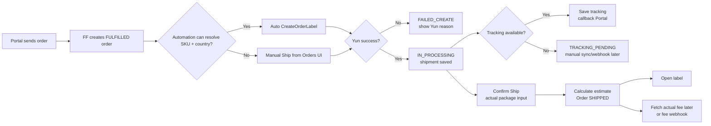

## 14. Operational Notes

- Orders are tenant-scoped at every business query.
- Portal APIs use tenant API key; dashboard APIs use session cookie.
- UI never calls YunExpress directly.
- Carrier calls go through shipment service and carrier adapter.
- Tracking callback is source-aware and should not confuse Amazon/Etsy flows.
- Etsy EU requires IOSS. Current default can be configured in Shipment Automation settings and edited in shipment modal.
- Auto shipment is best-effort after receive; failure does not reject the Portal receive batch.
- Manual ship remains the fallback path for unmapped SKU, method conflict, or carrier rejection.
- Webhooks update existing matched records only; unmatched events stay reviewable in Platform Yun Webhooks.
